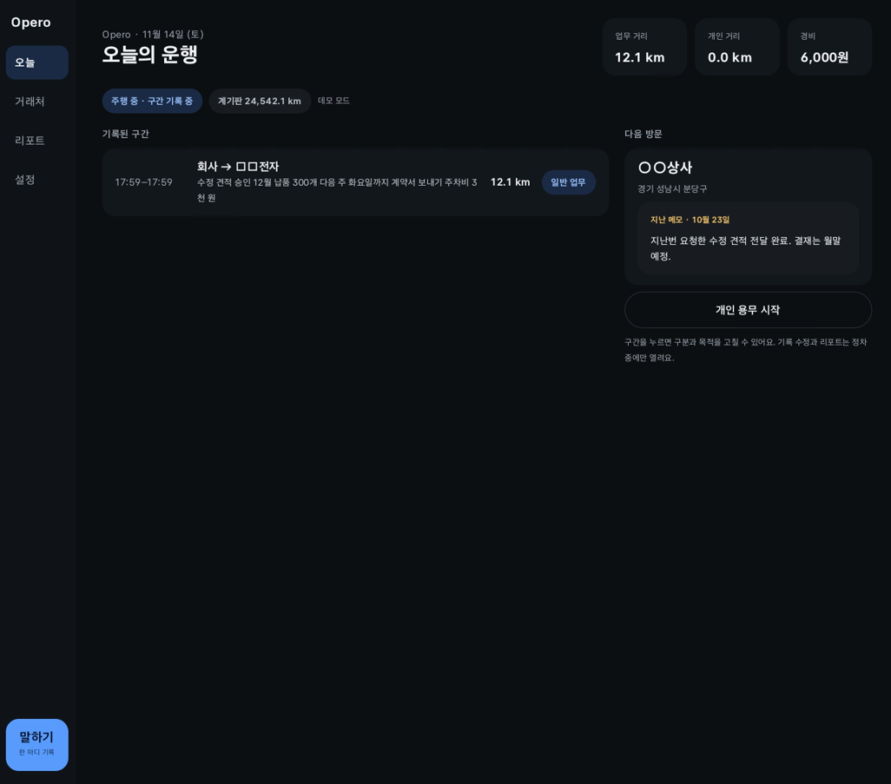
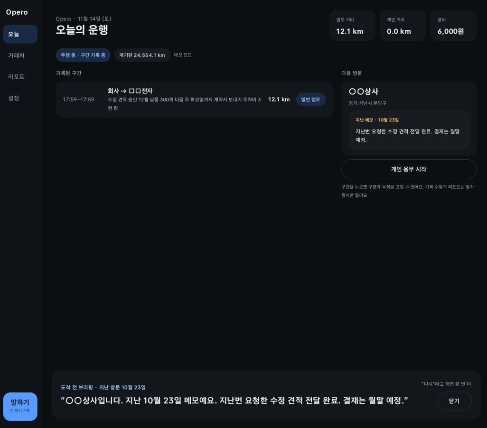
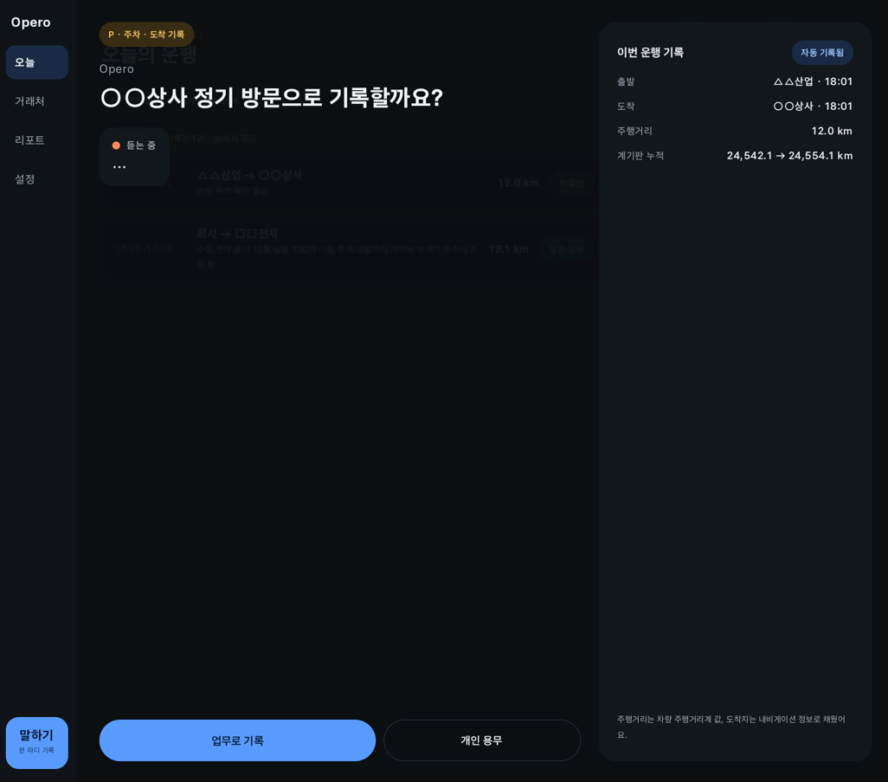
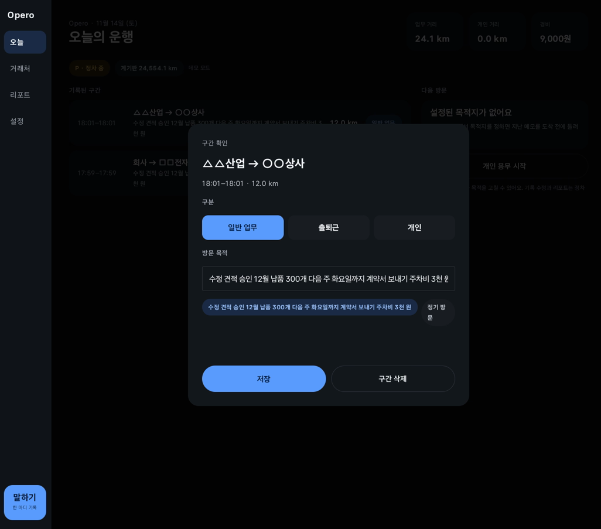
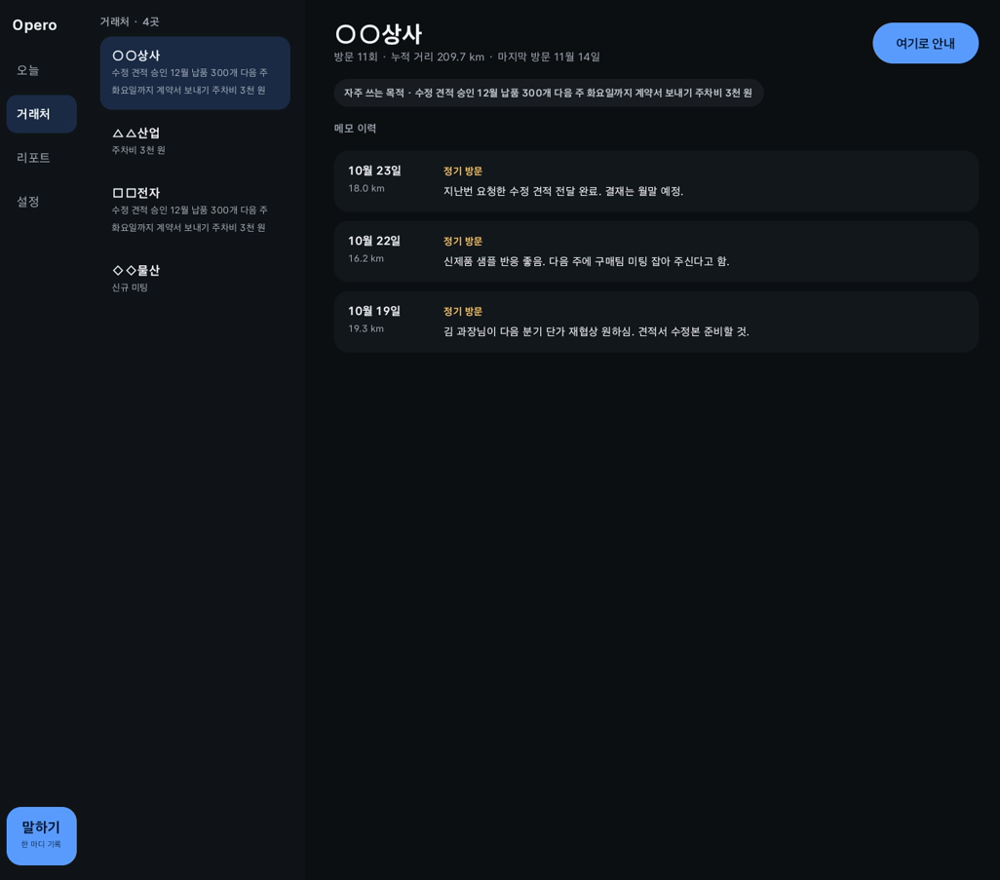
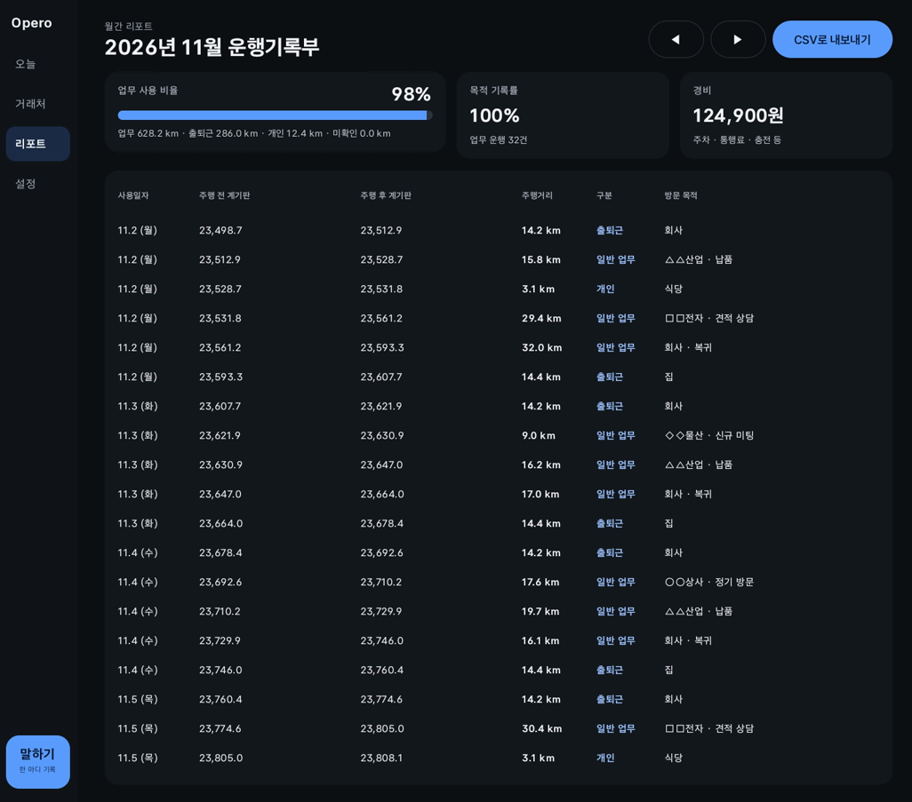

# Opero (오페로)

차를 일터로 쓰는 영업직·1인 사업자를 위한 **차 안 업무 비서**입니다.
현대자동차그룹 차량용 앱 개발 공모전(Pleos Connect) 출품작입니다.

> 타고 내리기만 하면 업무용 승용차 운행기록부가 남습니다.

## 주요 기능

- **자동 운행 기록**: 주차 브레이크·기어(P단)로 운행 구간의 시작과 끝을 잡고, 차량 주행거리계 값과 내비게이션 목적지·현재 위치 주소로 출발지·도착지를 채웁니다.
- **도착 순간 방문 목적 기록**: 정차하면 "○○상사 업무 방문으로 기록할까요?"라고 묻고, 지난 방문 목적을 제안합니다.
- **미팅 메모와 도착 전 브리핑**: 미팅을 마치고 운전석 문이 닫히면 메모를 받아 거래처별로 저장하고, 같은 거래처로 갈 때 도착 5분 전에 지난 메모를 읽어 줍니다.
- **‘말하기’ 버튼**: 언제든 한 번 눌러 "지금부터 개인 용무", "개인 용무 끝", "주차비 3천 원"처럼 말로 기록합니다.
- **기록 확인·수정**: 대답을 놓쳐 ‘미확인’으로 남은 구간을 정차 중에 업무·출퇴근·개인으로 정리하거나 삭제합니다.
- **월간 리포트**: 업무 사용 비율, 경비 합계, 국세청 고시 업무용승용차 운행기록부 항목 순서의 CSV 내보내기.
- **운전 안전**: 질문은 정차 중에만 하고, 주행 중에는 화면이 잠기며 브리핑만 읽습니다.

## 시연
https://github.com/user-attachments/assets/c6a870fc-3eae-4b19-8547-8ca533281a2f
- 시연 영상(1분, 데모 모드): [`demo/Opero_demo.mp4`](demo/Opero_demo.mp4)
- 아래 화면은 모두 Pleos Connect Emulator에서 실행한 실제 앱 화면입니다. 거래처·수치는 샘플 데이터예요.

| 정차 중 · 오늘의 운행 | 주행 중 · 도착 전 브리핑 |
|---|---|
|  |  |
| 오늘 기록된 구간과 다음 방문지, 지난 메모를 한 화면에. | 도착 5분 전, 같은 거래처의 지난 메모를 읽어 줍니다. |

| 도착 순간 · 방문 목적 기록 | 정차 중 · 구간 확인·수정 |
|---|---|
|  |  |
| 주차하면 이번 운행 기록과 함께 목적을 묻습니다. | 미확인 구간을 업무·출퇴근·개인으로 정리하거나 삭제합니다. |

| 거래처 · 방문·메모 이력 | 월간 리포트 · 운행기록부 |
|---|---|
|  |  |
| 거래처별 방문 목적과 미팅 메모가 날짜순으로 쌓입니다. | 업무 사용 비율·경비와 국세청 양식 CSV 내보내기. |

## APK

- `apk/Opero_release.apk` (minSdk 28, Pleos Connect Emulator API 34에서 확인)

## 실행

1. Android Studio(Ladybug 이상)에서 이 폴더를 엽니다. Gradle 동기화 때 Pleos Maven 저장소(`nexus-playground.pleos.ai`)에서 SDK를 받습니다.
2. **데모 모드(기본값)** 로 바로 실행됩니다. 오른쪽 데모 패널에서 목적지 → 출발 → 주행 → 도착 → 주차 → 음성 대답 순서로 눌러 하루 흐름을 볼 수 있습니다.
3. 설정 → 기록 관리 → **샘플 기록 채우기**를 누르면 지난 4주 영업 동선(거래처 4곳·메모·경비)이 채워져 리포트와 거래처 화면을 바로 볼 수 있습니다.
4. 설정 → 데모 모드를 끄면 Pleos 차량 SDK에 연결합니다. 연결 상태와 SDK 등록 결과는 설정 화면 맨 아래 ‘차량 연결 진단’에서 확인할 수 있습니다.

> Pleos Connect Emulator에서는 기어·문 열림 같은 차량 상태를 바꿀 수 없어, 그 장면은 데모 모드에서 같은 이벤트로 재현합니다. 차량 SDK 연결(주행거리·운전석 문·내비게이션 현재 위치)은 에뮬레이터에서 확인했습니다.

## 사용한 Pleos SDK

| SDK | 사용 API | 용도 |
|---|---|---|
| Vehicle SDK 2.3.2 | Odometer `registerDistanceDriven`, `getCurrentDistanceDriven` · Door `registerDoorPosition`(운전석) · Seat 안전벨트(보조) | 주행거리 기록, 미팅 후 재탑승 감지 |
| 차량 속성 (AAOS) | `PARKING_BRAKE_ON`, `GEAR_SELECTION` | 정차 판단(운행 구간 시작·종료) |
| NaviHelper 3.0.5 | `requestRoute`, `getDestinationInfo`, `onDestinationArrived`, `getCurrentLocationInfo`, `onRouteStateInfo`/`onTripInfo` | 방문지 안내, 도착 감지, 출발·도착 위치, 브리핑 시점 |
| SpeechToText / TextToSpeech 3.3.1 | ON_DEVICE 모드 | 질문·브리핑 음성, 대답 인식 |

## 구조

| 경로 | 역할 |
|---|---|
| `car/PleosCarSource.kt` | 차량·내비게이션 SDK 연결 |
| `car/DemoCarSource.kt` | 차량 없이 시연하기 위한 데모 이벤트 |
| `car/Reflect.kt`, `car/Diag.kt` | SDK 콜백 연결(메서드 이름 기반)과 연결 진단 기록 |
| `voice/PleosVoice.kt` | SpeechToText / TextToSpeech SDK |
| `core/SessionManager.kt` | 음성 대화 흐름 상태 머신(주행 → 브리핑 → 도착 질문 → 메모, 말하기 명령) |
| `core/IntentParser.kt` | 규칙 기반 대답 해석(응/아니, 업무/개인, 경비 금액) |
| `core/Report.kt` | 월간 요약과 운행기록부 CSV |
| `data/` | Room DB: 운행·거래처·메모·경비, 시연용 샘플 데이터 |
| `ui/` | Compose 화면(오늘, 거래처, 리포트, 설정, 질문 카드, 구간 수정, 데모 패널) |

## 다음 단계 (2차 PT까지)

- 리포트 QR 전송, 전기차 충전량 자동 기록(EvBattery), 내비 즐겨찾기 거래처 불러오기(getBookmarkInfo)
